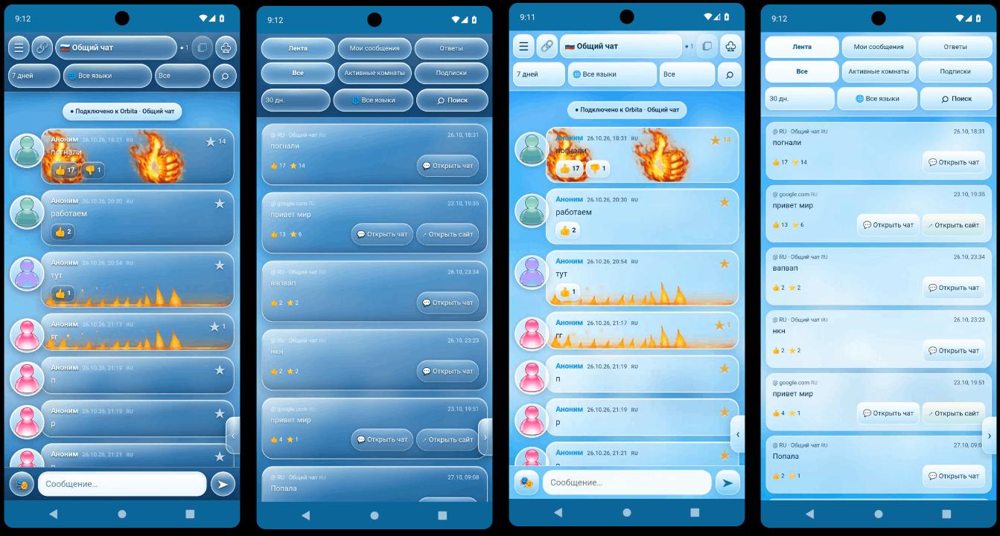

# 🌐 Orbita — Chat on Any Website

**English** · [Русский](README.ru.md) · [Deutsch](README.de.md) · [Français](README.fr.md) · [Español](README.es.md) · [Italiano](README.it.md) · [日本語](README.ja.md) · [中文](README.zh.md)

**[▶ Watch the preview](docs/preview.mp4)**

Orbita is a free extension for Chromium browsers that adds a chat to any website. Talk with other visitors without leaving the page. Stay anonymous — no registration required. Explore 85 thematic categories, create topics, and join open real-time discussions. Language-based chats, reactions, subscriptions, activity feed, and customization.

## ✨ Features

- **💬 Chat on websites:** floating, movable and resizable chat overlay with adjustable opacity.
- **🌍 8 interface languages and global chats:** **Russian (Русский), English, German (Deutsch), French (Français), Spanish (Español), Italian (Italiano), Japanese (日本語), Chinese (中文)**. Each language has its own global conversation.
- **🧩 85 thematic categories:** discover public discussions by interest, browse topics, and create your own topics within categories. Topic discussions are available without joining a private server.
- **🗣️ 54 chat languages:** choose a room language independently of the interface language.
- **🔗 Page-based rooms:** conversations are grouped by URL and language; mirrored websites can share a room.
- **👤 Anonymous participation:** site-specific nicknames and customizable avatars; no sign-up required.
- **👍 Community interactions:** upvotes, downvotes, stars, replies, reports, top posts and message filters.
- **🔥 Animated reactions:** fire, shield, fiery effects and other draggable effects with rechargeable charges.
- **🔔 Replies and activity:** a dedicated Replies view, message navigation and consolidated interaction notifications in newer builds.
- **📌 Subscriptions:** bookmark conversations and return to them.
- **🟢 Live activity:** online indicators and a directory of active public global rooms.
- **🎨 Customization:** Frutiger Aero glass styling, alternative themes, backgrounds, gradients and notification sounds.

## 📱 Orbita for Android — v0.3.22

Orbita is also available as a standalone Android app. Chat on websites and in language-based global rooms directly from your phone, without a browser extension.

**Android features:** anonymous chats and avatars; global rooms and website-specific discussions; 8 interface languages and 54 room languages; likes, dislikes, stars, replies and reporting; social feed, search, filters and subscriptions; animated message effects; glass themes including Frutiger Aero and Blue-Grey.

**Installation:** download `Orbita-android-v0.3.22.apk` from [GitHub Releases](https://github.com/MeLord2024/Orbita/releases), open the APK on your Android phone, and confirm installation. This is a testing build; allow installation from this source only if you trust the file.

## 🚀 Install from ZIP

1. Open **[Releases](https://github.com/MeLord2024/Orbita/releases)** and download the version you want.
2. Extract the ZIP into a permanent folder.
3. Open `chrome://extensions`, enable **Developer mode**, then select **Load unpacked**.
4. Select the extracted `extension` folder containing `manifest.json`.
5. Open a website and click the Orbita extension icon (or use its configured shortcut).

**Requires:** Chromium-based browser version 114 or newer. Orbita is currently distributed as an unpacked ZIP, not through Chrome Web Store.

> **Version note:** GitHub's currently published release and source tree may lag behind the latest privately tested build. Check the release version before installing. Do not deploy an older server implementation over a newer live Worker.

## 🔒 Privacy and security

## 🌍 Languages

- [English](README.md)
- [Русский](README.ru.md)
- [Deutsch](README.de.md)
- [Français](README.fr.md)
- [Español](README.es.md)
- [Italiano](README.it.md)
- [日本語](README.ja.md)
- [中文](README.zh.md)
