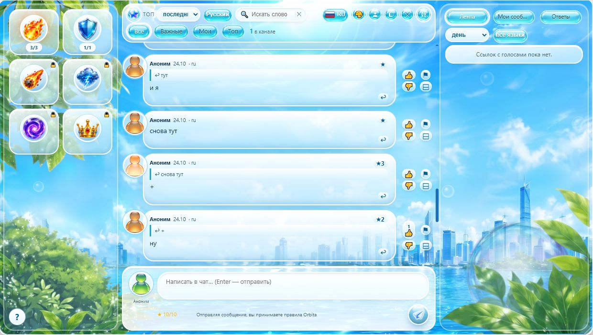

# Orbita — чат поверх любого сайта



Прозрачное окно чата прямо на странице. Комната привязана не к сообществу, а к **адресу
страницы + языку**: открыли статью, видео или тред — вокруг этого адреса свой чат. Расширение
на Manifest V3, без единой npm-зависимости, с сервером синхронизации на бесплатном Cloudflare
Worker. Аккуратный читатель заметит: это не «комменты к сайту», а чат людей, которые смотрят
одно и то же. На скриншоте — скин **Frutiger Aero**, включённый по умолчанию.

## Возможности

- **Оверлей, а не вкладка.** Перетаскивается за шапку, меняется в размере, `Esc` прячет,
  прозрачность регулируется. На вкладке всегда ровно одно окно. Если сайт не открылся вообще
  (мёртвый домен), чат откроется отдельной вкладкой — и там окно тоже можно таскать за шапку
  и тянуть за угол, размер запоминается.
- **Без регистрации.** Аноним по умолчанию, ник — свой для каждого сайта («крокодил» на одном,
  «лобстер» на другом, ничем не связаны). `http://` и `https://` одной страницы — одна комната.
- **Зеркала сайтов в одной комнате.** Статья с основного адреса и с зеркала — один чат,
  у каждого комментария метка, с какого адреса он написан.
- **Голоса, звёзды, модерация без модератора.** ▲/▼, 10 звёздочек «важное» за сутки,
  три жалобы или десять минусов сворачивают комментарий в серую полосу — но счётчик минусов
  остаётся видимым: видно, за что именно человеку прилетело.
- **Анимации перетаскиванием.** Значок зажимают и тянут на чужой комментарий: огонь (3 заряда
  в сутки) или щит (1 заряд), который этот огонь тушит. По мотивам флеш-эстафет нулевых,
  всё бесплатно, лимит нужен, чтобы лента не превращалась в костёр.
- **Правая панель в три раздела:** общая лента топа со всех чатов, свои комментарии по всем
  каналам и «Ответы» — то, что написали именно вам, со счётчиком на вкладке.
- **Скины**, включая Frutiger Aero (стекло, aurora-фон, стеклянные аватары), свой фон и градиент,
  звук оповещений (три встроенных тона + свой mp3).
- **Интерфейс на 8 языках** (RU, EN, DE, FR, ES, IT, JA, ZH) и 54 языка комнат.

## Установка

Нужен браузер на Chromium (Chrome, Яндекс, Edge, Vivaldi) версии 88 и новее.

1. Скачать `orbita-v0.4.17.zip` в [Releases](https://github.com/MeLord2024/Orbita/releases/latest).
2. Распаковать в любую папку, которую не будете удалять (расширение читается из неё при каждом запуске).
3. `chrome://extensions` → включить **Режим разработчика** → **Загрузить распакованное расширение** →
   выбрать папку `extension`.
4. Открыть любую страницу и нажать `Alt+O` (или `Alt+Shift+O`, или кликнуть по значку Orbita).
   Если обе комбинации молчат — их занял кто-то другой: назначить свои можно на
   `chrome://extensions/shortcuts`.

Подробные шаги, частые вопросы и что делать, если сайт не принимает оверлей, — в [INSTALL.md](INSTALL.md).

## Приватность: что уходит наружу

Синхронизация включена по умолчанию, и адрес сервера зашит в сборку (его нельзя поменять
в интерфейсе — иначе любой, у кого есть доступ к настройкам, смог бы направить клиентов
на свой сервер). Это значит, что ваш первый комментарий увидят незнакомцы в комнате этого
адреса. Общий сервер выключается переключателем в настройках — тогда клиент не делает
ни одного запроса наружу, а история живёт в браузере.

Что при включённой синхронизации **не** уходит:

- `deviceId` — наружу едет производный публичный алиас, по которому человека нельзя проследить
  между сайтами;
- адрес комнаты в явном виде — счётчик «в канале» оперирует токеном `sha1(адрес + язык)`,
  так что сервер не собирает историю посещений;
- право удалять своё — ключ выводится на лету из `deviceId` и id сообщения, на сервере лежит
  только его хэш; подделать чужое удаление, сняв хранилище браузера, нельзя;
- IP открытым текстом — бакеты лимита постов ключуются `sha256(IP + сутки)`.

Сообщения хранятся 30 дней, дальше их вычищает `prune` на сервере. В репозитории нет ни одного
ключа, токена или секрета: сервер не требует авторизации вообще.

## Статус фич: полный чек-лист

Ниже — таблица по всему ТЗ, включая то, что сознательно не сделано (регистрация через Google
и монетизация — только по явному запросу).

| Фича из ТЗ | Статус |
|---|---|
| Зелёная иконка с числом пользователей на данной странице (`99+`) | работает, `chrome.action.setBadgeText` по вкладкам |
| Клик по иконке / `Alt+O` → разворачивается оверлей-чат | работает, изолированный iframe поверх сайта |
| Прозрачность оверлея, перетаскивание, ресайз, `Esc` | работает: панель тянется за шапку чата плавно (координаты экрана + один шаг на кадр), ползунок прозрачности — в панели «🎨 оформление» |
| Анонимность по умолчанию («Аноним»), ник до 67 символов — хоть анону, хоть зарегистрированному | работает: в профиле крупное поле ввода (ширина всей карточки, счётчик символов), предупреждение о публичности ника |
| Ник запоминается отдельно для каждого сайта | работает: «крокодил» на vk.com, «лобстер» на другом — при следующем открытии каждый сайт помит своё; в профиле подпись «Ник этого сайта: хост» и кнопка «сбросить ник этого сайта» |
| Размер и положение окна чата — по каждому сайту | работает: `orbita.geom` хранит `{default, sites{хост}}`; перетаскивание и ресайз сохраняются для точного хоста (без `www.`), новые сайты получают окно дефолтного размера |
| Зеркала сайтов в одном чате | работает: кнопка «⛓ зеркала» перед «✕» → поле адреса → `+`; сообщения, голоса, звёзды, жалобы и счётчик онлайн у объединённых адресов общие, у каждого комментария метка «@ хост», откуда он; любой адрес можно отцепить ножницами «✂» — его посты возвращаются в его собственный чат |
| Стеклянные аватары: случайный градиент за каждым ID, картинка — только зарегистрированным | работает, 40 градиентов, стабильны при прокрутке |
| Голоса ▲ / ▼ по каждому сообщению | работает, один голос с устройства на сообщение |
| «Важные» — 10 звёздочек за 24 часа, фильтр «Важные» | работает, скользящее окно, возврат звезды при отмене |
| Топ за день / неделю / месяц / год / за всё время | работает (переключатель «Top» + вкладка «Топ») |
| Языковые комнаты, EN/RU/DE/ES наверху, поиск по названию языка | работает, 54 языка |
| Левая панель анимаций (выдвигается/задвигается) | работает: значки рисуются SVG-артём в цвет скина, перетаскивание мышью — см. следующую строку |
| Анимации перетаскиванием: огнеметчик и защитник | работает: значок зажимают и тянут на аватарку или сообщение соседа. **Огнеметчик** (`fx.flame`) — 3 заряда в сутки: по комменту идёт горение (языки пламени, угли, тепловой ореол), на аватар садится горящий значок. **Защитник** (`fx.shield`) — 1 заряд в сутки: тушит горение (над сообщением поднимается пар) и вместо огня включает золотое свечение аватара и пузыря, а на аватарке справа снизу появляется щит. Заряд тратится только если что-то изменилось: отказ quota не тратит ничего, второй щит по щиту и огонь под щитом (`«Под щитом огонь не берёт»`) — тоже. Огонь не кладут на то, что уже горит, щит не тушит то, что уже под щитом. Счётчик `осталось/всего` виден на карточке, пустая карточка не перетаскивается. Без мыши тоже можно: клик по карточке «взводит» значок, клик по аватарке — наносит |
| Эффект живёт на сообщении, а не на кадре | работает: `msg.effect = {type, by, ts}` уезжает на сервер через уже существующую `/api/patch`, поэтому горение или защита видны всем в комнате и держатся, пока их не потушат; конфликты разрешаются по `ts`. Старые `type:"dragon"` дочитываются как огонь — **сервер для этой версии перезагружать не нужно** |
| Кнопки «✦» и «⛓» только открывают и закрывают панели | работает: чат стоит на месте — ширина уезжает в окно оверлея, а не в колонку чата; колонка чата закреплена за своей ячейкой сетки |
| Правая панель с тремя вкладками: «Общая лента», «Мои сообщения» и «Ответы» | работает: «Общая лента» — топ Орбиты со **всех** чатов: строки образуются из комментариев с наибольшим числом лайков (голоса ▲/▼, звёзды ★), а не только из тех, к кому приложены ссылки; до 30 строк, в каждой строке — сам текст и до 3 чипов-ссылок «Hyperlink 1..3», если они в комментарии есть. «Мои сообщения» — ваши последние комментарии во всех чатах, сверху новые по дате, тем же списком; активная вкладка подсвечена цветом скина. **«Ответы»** — то, что написали именно вам: в строке адрес сайта и языка, ниже короткая **ваша** реплика, под ней — начало ответа, и клик по строке ведёт прямо к этому ответу (откроется сам сайт с оверлеем, прокрутка до комментария). Скрытые по жалобам или минусам ответы в раздел не попадают, счётчик непрочитанных висит на самой вкладке — его видно, даже когда панель закрыта |
| Ответ на чужое сообщение помечает родителя | работает: кнопка «↩ отвечать» кроме цитаты теперь сохраняет и **id** родителя (`msg.replyTo`), он уезжает на сервер в колонке `reply_to` и возвращается в `pull`. Без этой связи «мне ответили» неоткуда вычислить. В ленте комнаты у вашего комментария появляется значок «↩ N» — сколько ответов пришло. Если сервер старее v0.3.1 и колонку не вернул, родитель добирается **по тексту цитаты**: совпадение в той же комнате, среди ваших сообщений, не новее ответа и длиннее четырёх символов — так «Ответы» работают и против воркера v0.2 |
| Порядок строк в ответе | работает: блеклая **цитата стоит сверху, ваш ответ — под ней**, как на форумах: читают сверху вниз и последним видят то, ради чего в тред зашли |
| Пустой ход оверлея не стоит ничего | работает: с v0.3.4 в окне чата **ноль перерисовок, пока никто ничего не делает**. Анимации огня и щита больше не трогают `box-shadow` и `background-position` (это растер всего пузыря каждый кадр) — свечение, рамка и градиент стали статичными, движение осталось только на `transform` и `opacity`. Движется лишь то, на что смотрят: `IntersectionObserver` оставляет `.live` только видимым строкам, поэтому горящий коммент вне экрана замирает, не меняясь на вид. Значки в ящике анимаций дышат, пока на панель наведён курсор или заряд выбран. Ползунок прозрачности окна при 100 % вообще снимает `opacity` с панели — без этого окно висело отдельным альфа-слоем поверх сайта. Пустой `sync` (long-poll каждые ~40 с) больше не пересобирает ленту: совпал отпечаток сообщений — DOM не тронут. И `applyTheme` не перезаписывает CSS-переменные одинаковыми значениями, а сохранение темы отложено на 350 мс, поэтому взмах ползунка не пишет в `chrome.storage` на каждый пиксель |
| Стекло Frutiger Aero выключается галкой | работает: в панели «🎨 оформление» появился переключатель «Матовое стекло (нагружает видеокарту)» — он один отвечает за `backdrop-filter` и скрыт для не-стеклянных скинов. С снятой галкой Frutiger Aero остаётся тем же скином (aurora, полупрозрачные панели, скругления, та же читаемость), но не просит у видеокарты ни одного размытия. Выбор живёт в теме и не сбрасывается при смене скина |
| Кнопки шапки попадятся с первого раза | работает: пилюли «язык интерфейса», «язык комнаты», 🎨, профиль, зеркала и «✕» были 21-26 px высотой, с зазором 4-6 px между ними и скруглением 999px — углы пилюли и щели между кнопками кнопке не принадлежали, и чтобы открыть список языков, нужно было целиться в середину. С v0.3.5 у каждой кнопки шапки есть невидимая зона нажатия на 5 px шире самой пилюли: пикселей, где клик не работает, в ряду больше нет (проверено потактовой картой `elementFromPoint` — 0 мёртвых точек между кнопками). Выглядят они ровно как раньше, а пустое место в шапке под перетаскивание окна осталось |
| Подсказки в профиле читаемы | работает: строки «лимит ника» и «картинку-аватар загружает только зарегистрированный» красились `--star` — янтарём со звёздочки. В светлых скинах это жёлтый текст по белому стеклу. С v0.3.5 они пишутся обычным цветом чернил скина; янтарным остался только счётчик предупреждений у скрытого комментария, где цвет несёт смысл |
| Жалоба «⚑» снимается вторым кликом | работает: с v0.3.6 ⚑ — переключатель. Первый клик вписывает ваш псевдоним в `msg.reports` и зажигает кнопку красным, второй вычёркивает её оттуда же, и кнопка снова обычная (в стенде: после первого клика `aria-pressed=true` и цвет `rgb(239,68,68)`, после второго — `false` и обычный цвет). До этого `report()` умела только дописывать, поэтому flag горел навечно. Спрятанный по жалобам комментарий перестаёт быть спрятанным, если после снятия их осталось меньше трёх |
| Звёзды «важное» больше не накручиваются | работает: снятая звезда теперь **покидает сервер**. `vote`, `toggleStar` и `report` возвращают `withdrawn = {поле: [псевдоним]}`, он улетает в `/api/patch` новым полем `rm`, и воркер вычёркивает псевдоним из массива (раньше сервер умел только складывать: отсутствие псевдонима в присланном списке для него не значило ничего, и снятая запись возвращалась с каждого pull). Вторая защита — клиентская: `mergeRemote` дополняет чужие псевдонимы, но свои считает по местному списку, поэтому даже сервер, который `rm` не понимает, не вправе вернуть вам снятую звезду. Журнал квоты стал картой «сообщение → когда»: раньше снятие вычёркивало последнюю по времени отметку, то есть чужой заряд. В стенде шесть кликов по ★ подряд дают 9/10 ↔ 10/10 — выше десяти не поднимается |
| На старом сервере снятые записи ещё видны соседям | ограничение: живой воркер сегодня — сборка v0.2 (проверено прямым `pull`: у сообщений в базе нет колонки `reply_to`, поля `rm` он тоже не знает). Пока `server/cloudflare/worker.js` не вклеен в Cloudflare Dash заново, снятая звезда или жалоба исчезает только у вас, а у соседей ваш псевдоним остаётся в списке. Ничего не ломается: клиент v0.3.6 рассчитан и на v0.2 |
| Стекло Frutiger Aero не ест видеокарту | работает: размытие осталось **на трёх крупных неподвижных поверхностях** (колонка чата, правая панель, ящик анимаций) плюс по одному слою на открытые поповер и оповещение. Раньше `backdrop-filter` висел и на каждом пузыре, и на каждой строке ленты, и на всех кнопках — это слой композитора на каждое сообщение, и все они перерисовывались каждый кадр скролла (на тестовой комнате из ~90 элементов: 92 поверхности против 9 сейчас, и старое число росло вместе с лентой). Токены цвета не тронуты, читаемость та же |
| На вкладке всегда ровно одно окно чата | работает: второй оверлей больше не может лечь поверх первого. Раньше клик по строке ленты с адресом без `www.` считался другой страницей, окно пересобиралось, а старый хост оставался висеть — и у него не работали ни «✕», ни иконка расширения, ни перетаскивание. Теперь показ окна сначала снимает прежнее, адрес сверяется так же, как `normalizeUrl` (без `www.`, без хвостового слэша, `?` и `#` не в счёт), а гонка двух открытий подряд обрывается по номеру сборки: окно строит только последний клик |
| Переход из «Мои сообщения» и «ленты» к своему комменту | работает: клик по строке прокручивает текущий чат к сообщению и подсвечивает его; для чата на другом сайте команда `site:open` открывает **сам сайт** новой вкладкой и навешивает оверлей после загрузки (`pendingOverlay` + `tabs.onUpdated`). Если вкладка этой же страницы уже открыта — она получает фокус, оверлей разворачивается на месте, и второй экземп сайта не создаётся (совпадают хост без `www.` и путь; `?utm=` и якоря не считаются другой страницей). Если Chrome не отдаёт страницу (заблокирован, домен скрыт, сайт выдуман) — открывается прежняя вкладка Orbita с чатом |
| Чат не уезжает в низ при голосовании и фильтрах | работает: «прилипание к низу» замеряется **до** очистки ленты, а не после — иначе пустая лента всегда считается прокрученной до конца. ▲/▼, ★, смена периода или языка в правой панели оставляют вас там, где вы смотрели; вниз чат идёт только при новом входящем сообщении, собственном комментарии и переходе к своему комменту |
| Фильтры периодов в правой панели | работает: «последние» (первым пунктом, без временного окна — сверху новые по дате), день / неделя / месяц / год / за всё + фильтр языка; список прокручивается внутри панели, шапка и фильтры остаются на месте |
| Фильтр времени «последние» первым пунктом | работает и в самом чате, и в правой панели: сортировка по порядку времени без временного окна. В чате «последние» = 100 самых свежих комментариев (дефолт при открытии), «за всё» = архив целиком; кнопка перехода к своему сообщению сама раскрывает период до «за всё», чтобы найти старый коммент |
| Переводы интерфейса: RU, EN, DE, FR, ES, IT, JA, ZH | работает: кнопка с флажком в шапке → список языков с флажками; тот же выбор в профиле, в настройках и на старте; по умолчанию берётся язык браузера |
| Шапка чата в два ряда: 1-й — «✦», топ-период, язык чата, поиск, флажок интерфейса, «🎨», профиль, «✕», «⛓»; 2-й — «Все/Важные/Мои/Топ» и счётчик онлайн | работает |
| Удаление своего сообщения (🗑 после «⊟») | работает: два нажатия — подтверждение, затем сообщение удаляется у всех; на сервере остаётся «надгробие», так что оно не возвращается при синхронизации. С v0.3.0 сервер сверяет не имя автора, а **ключ на удаление** — `sha256(deviceId#id-сообщения)` с солью `@orbita.del`. Значение нигде не хранится и выводится на месте: подделать чужое удаление нельзя, даже зная адрес комментария |
| Публичный алиас вместо deviceId | работает: наружу из `author.id` и счётчика онлайна уезжает детерминированный `u` + 24 hex-символа, а сам deviceId не появляется ни в одном запросе (проверяет `tests/test_transport.mjs`). В одной комнате человек выглядит одинаково для всех, но по алиасу его нельзя ни проследить между сайтами, ни удалить его посты. Комментарии, написанные до v0.3.0, подписаны старым deviceId — они остаются «своими»: кнопка 🗑 на месте, «Мои сообщения» их видят, сервер сверяет прежнего автора |
| Приватность адресов страниц | работает: «онлайн» считается по **токену комнаты** (`sha1(url#язык)` с солью, 32 hex), поэтому в таблице присутствия больше нет истории посещений; `normalizeUrl` оставляет только разрешённые query-параметры (`v`, `id`, `p`, `post`, `t`, `page`, `chat`, `room`, `msg` и ещё несколько), а `?fbclid=` / `?gclid=` / `?utm=` выкидывает — ссылка и репост попадают в ту же комнату, что и сама страница; лимит постов считается по `sha256(IP + сутки)`, а не по голому IP |
| Прокрутка чата | работает: лента прокручивается внутри своей колонки, панель ввода и кнопка отправки всегда остаются внизу, новое сообщение попадает в вид |
| Кнопка «🎨 оформление»: 8 скинов + особый скин + свой градиент + свой фон | работает: по умолчанию «Лазурь», «Милитари» в конце списка; кружок цветов как в Photoshop, прозрачность 0–100 % у градиента и фона, режимы заполнения (растянуть / вписать / замостить / по центру / повторить), фон и градиент складываются; иконки «✦ анимации», «⛓ лента», «➤ отправить» окрашены в цвет скина |
| Звук в панели «🎨 оформление» | работает: переключатель «Оповещать о новых сообщениях», три встроенных оповещения — **«капля»** (короткая нисходящая пара тонов), **«перезвон»** (восходящее трезвучие) и **«импульс»** (мягкий «гул» на треугольной волне). Все три синтезируются на лету через WebAudio (`extension/sound.js`), поэтому в архиве нет ни одного аудиофайла и сборка не растёт |
| Свой mp3 для оповещения | работает: «Загрузить звук» принимает `.mp3` / `audio/mpeg` до 3 МБ, файл уезжает data-URL-ом в `chrome.storage.local` под отдельным ключом `orbita.sound` (расширение с `unlimitedStorage`, так что лимит 10 МБ общим ключом не упирается) и играет вместо встроенного; кнопка «✕» возвращает встроенный звук. Настройки хранятся раздельно: удаление оформления (`orbita.theme`) звук не трогает |
| Ползунок громкости | работает: 0–100 %, шаг 5, подпись «Громкость · NN %»; громкость множит амплитуду синтезируемой волны и `Audio.volume` у своего файла, при 0 звук молчит совсем. Оповещение звучит только на чужие новые сообщения (свои не звонят), первый прогрев ленты после открытия молчит, и пока вы не кликнули по чату браузер не даёт звуку стартовать — первый клик «размораживает» аудиоконтекст |
| Frutiger Aero — скин по умолчанию | работает: при установке сразу включается Aero, градиент чата прозрачный (alpha 0), окно оверлея на 100 % непрозрачное. Фон — сцена (`extension/bg/aero.jpg`: небо, облака, океан, город), поверх которой **canvas** (`extension/scene.js`) рисует живую воду (полоски со сдвигом по синусу), яркий солнечный блик с кольцами и дорожкой на воде и всплывающие пузыри. Зелень и стеклянная сфера — вырезанные PNG (`bg/leaf-tl.png`, `bg/leaf-bl.png`, `bg/leaf-br.png`, `bg/sphere.png`): листья заметно покачиваются (до ±1.8°), а шар лежит ПОД листвой в правом нижнем углу — снизу его прикрывают непрозрачные листики; внутри шара медленно гуляет блик, сам шар чуть поворачивается. Скорость шара — отдельный ползунок «Скорость сферы» в 🎨. **Три эффекта включаются отдельно** ползунками в 🎨: «Пузыри», «Солнце», «Растения» — 0 выключает, 100 даёт максимальную скорость. Звезда «важное» при отметке вытягивается в овал и показывает «★ N»; сняли свою звезду и других нет — снова круг. **Плотность боковых панелей** — отдельный ползунок, по умолчанию 10 % (почти прозрачное стекло, сквозь которое видно сцену; 100 % — плотное молочное). Аватары — стеклянные человечки: 25 готовых PNG в `extension/avatars/`, номер выбирается хэшем псевдонима, поэтому человек одинаков во всех комнатах. Значки анимаций — тоже картинки (`extension/icons/fx-*.png`: огонь, щит, метеор, шторм, портал, корона), кнопка ✦ и отправка — глянцевые star.png и send.png. Матовое стекло по умолчанию выключено: это самый дорогой эффект на видеокарте. Кнопки — круглые глянцевые «капли», медальоны значков 52 px с цветным свечением, пузыри с верхней белой полосой-бликом. Движение — только `transform` и `opacity`; сцена не масштабируется, у солнца анимируется только прозрачность (это и есть ответ на нагрузку), `prefers-reduced-motion` уважается |
| Кнопка «⊟ скрыть» под сообщением | работает: сообщение и аватар сворачиваются в узкую полоску, ▲/▼, ★ и ⚑ остаются на месте, а «⊟» превращается в «⊡ развернуть» в той же ячейке; состояние хранится в `chrome.storage` |
| Поиск слова в чате (со скетча) | работает |
| Жалоба ⚑, 3 жалобы — сообщение скрыто | работает |
| 10 минусов — сообщение скрыто, но счётчик виден | работает: как только чужие голоса ▼ доходят до `DOWNVOTE_HIDE_AT = 10`, комментарий прячется сам, без админа. На его месте остаётся заглушка «скрыто по минусам» с **числом ▼ 10** рядом (и ⚑N, если есть жалобы) и кнопкой «👁 показать» — она открывает текст в этом же чате. Скрытое не попадает в «Общую ленту» и в топ, но остаётся в ленте комнаты помеченным: минус должен быть виден, а не «сообщение исчезло». Переключатель «показывать скрытые» в настройках работает поверх обоих правил — и по жалобам, и по минусам |
| Стоп-слова, rate-limit 5 сообщений / 20 с | работает, и в клиенте, и на сервере |
| Сохранение сообщений | локально в `chrome.storage` (в папку расширения Chrome писать нельзя — она только для чтения) + JSON-хранилище на сервере |
| Общий чат между людьми (не только в своём браузере) | работает: те же шесть `/api/*` ручек подняты на двух бесплатных хостингах — Cloudflare Worker + D1 (`server/cloudflare/`) и Supabase Edge Function + Postgres (`server/supabase/`), установка пошагово в `INSTALL.md`. В расширение не вписан ни один ключ: клиент ходит только по HTTPS-URL сервера |
| Адрес общего сервера зашит в сборку | работает: `SERVER_URL` в `extension/store.js`, в настройках остался только переключатель «Общий сервер» и его статус. Поле с URL убрано нарочно: зная настройки, расширение можно было направить на свой сервер и снимать переписку всех комнат |
| Быстрая доставка сообщений (long-poll) | работает: `GET /api/pull` держит соединение до 40 с и отвечает в момент, когда сосед написал, — сообщение доезжает за 1-4 с вместо 15-30. Свой комментарий уходит на сервер сразу после отправки, не дожидаясь очереди. Chrome будит service worker alarm-ом раз в 30 с, но сам будильник сервер не опрашивает |
| Онлайн-счётчик в серверном режиме | считает реальных людей в комнате, а не только ваши вкладки: маяк «онлайн» едет **внутри** того же pull-запроса (`dev` + `beat`), не чаще раза в 4 минуты и только по комнате, в которую человек смотрит в данный момент — свёрнутая вкладка гаснет через 5 минут, а скрытый чат перестаёт опрашивать сервер вовсе. С v0.3.0 в `beat` лежит токен комнаты, а не её адрес, и `dev` начинается с публичного алиаса. В локальном режиме счётчик остался по вкладкам |
| Общение при заблокированном сайте | работает через страницу канала в настройках: «Настройки» (ПКМ по значку) → ввести адрес → «войти» → чат открывается в новой вкладке без загрузки сайта |
| Выдуманный или недоступный сайт | оверлей недоступен только там, где Chrome не показывает свою страницу ошибки; чат открывается тем же стандартным окном 1180×680 по центру, а не растянутым на весь экран, и комната просто пуста |
| Перехват новой вкладки Chrome | **убрано**: Orbita больше не подменяет стартовую страницу — вход в канал, недавние комнаты и ники по сайтам живут в «Настройках» (ПКМ по значку расширения → «Настройки») |
| Регистрация через Google, монетизация анимаций | **не в этой сборке** (слот `identity.userId` в модели данных уже есть) |
| Перевод самого текста правил | **не в этой сборке**: переведён интерфейс (8 языков), `rules.html` пока на RU/EN |

## Сервер: что и когда надо перезаливать

Готовая сборка лежит в [Releases](https://github.com/MeLord2024/Orbita/releases/latest),
расширение ставится из папки `extension` — см. «Установка» выше.

v0.3.0 и v0.3.1 — сборки, где **нужно тронуть сервер**. В v0.3.0 воркер поменял presence,
проверку удаления и лимиты, в v0.3.1 к ним добавилась одна колонка `reply_to` — без неё
раздел «Ответы» видит только ваши локальные ответы и теряет те, что пришли с сервера.
Порядок один: сначала `server/cloudflare/migrate-v0.3.sql` в D1 (она закрывает обе сборки,
`alter table ... add column` в SQLite исполняется по одной инструкции), потом redeploy
`worker.js`, и только после этого переустанавливайте расширение. Клиенты старых
сборок при этом не ломаются — воркер по-прежнему принимает сырой адрес комнаты и удаление по
имени автора для строк, записанных до миграции. С v0.3.2 серверные шаги стали **не обязательными
для «Ответов»**: воркер v0.2 не хранит `reply_to` и возвращает только текст цитаты, и клиент
находит родителя по нему. Совпадение по тексту — лучшая доступная гарантия, поэтому связь
всё же надёжнее на сервере: после миграции и перезаливки ответ доезжает с точным id.

v0.3.6 меняет `/api/patch` ещё раз: кроме четырёх массивов клиент присылает `rm` — список
псевдонимов, которые надо **вычеркнуть** (снятые голос, звезда, жалоба). Миграции в базе для
этого нет, колонки не тронуты: нужен только redeploy `worker.js`. До перезаливки снятые
записи исчезают только у вас (клиент больше не верит серверу в отношении своих псевдонимов),
а соседям их показывает лента, пока воркер не станет новой версии.

## Структура

```
extension/         Manifest V3, грузится как «неупакованное расширение»
  manifest.json     разрешения, иконки, Alt+O (стартовую страницу Chrome больше не перехватываем)
  background.js     service worker: presence, бейдж, маршрутизация команд, цикл long-poll синхронизации
  store.js          слой данных: каналы, зеркала, сообщения, голоса, звёзды, жалобы, эффекты и их заряды
                    (FX_QUOTA: огонь 3, щит 1 в сутки, скользящее окно), ники по сайтам, публичный алиас
                    (publicAlias), токен комнаты (roomToken), ключ на удаление (deleteTicket), правило
                    сокрытия hideReason (3 жалобы / 10 минусов), связи «ответ на» (replyTo) с выдачей
                    answers/readAnswer и поиском родителя по тексту цитаты (quoteIndex), лимиты и
                    зашитый адрес общего сервера (SERVER_URL)
  content.js        внедрение оверлея (shadow DOM + iframe), геометрия окна по хосту, приём drag/opacity/панели от шапки чата,
                    разворот чата по команде background (overlay:open) и возврат на вкладку чата, если сайт оверлей не принял
  fx.js             SVG-арт значков: огнеметчик в чёрном шлеме и золотой щит (цвет берёт из токенов скина)
  sound.js          три встроенных оповещения на WebAudio (капля / перезвон / импульс) + проигрыватель своего mp3,
                    разморозка аудиоконтекста по первому клику
  chat.html/css/js  интерфейс: три колонки, зеркала, профиль с ником этого сайта,
                    правая панель в три вкладки («Общая лента» / «Мои сообщения» / «Ответы» со счётчиком),
                    в пузыре сообщения — цитата сверху и ответ под ней,
                    перетаскивание значка на сообщение и анимации горения / золотой защиты,
                    звук в панели «🎨 оформление», сохранение позиции ленты при голосах и фильтрах
  themes.js         скины, токены цвета (в том числе `--flame` и `--gold` для анимаций), градиенты, фон
                    оверлея и стеклянные аватары-градиенты
  langs.js          54 языка + поиск
  locales.js        строки интерфейса: RU + EN, сюда же подмешиваются остальные переводы
  locales_more.js   DE, FR, ES, IT, JA, ZH — по 171 ключу в каждом
  flags.js          8 флажков для смены языка интерфейса (инлайновые SVG: Windows не рисует флаги-эмодзи)
  sanitize.js       нормализация URL, извлечение ссылок, стоп-слова
  options.*         настройки: вход в канал по адресу, недавние комнаты, ники по сайтам, переключатель общего
                    сервера и его статус, сайты-исключения, очистка данных
  rules.html        правила чата (RU/EN)
server/server.js    прототип выделенного сервера, ноль зависимостей (node server/server.js)
server/cloudflare/  общий сервер на Cloudflare: schema.sql (D1/SQLite), worker.js (Worker)
                    и migrate-v0.3.sql — одна миграция поверх старой базы для этой сборки
server/supabase/    общий сервер на Supabase: schema.sql (таблицы + RPC) и function_orbita.ts (Edge Function)
tests/test_store.mjs     132 проверок слоя данных (node tests/test_store.mjs)
tests/test_cf_worker.mjs 31 проверка общего сервера: тот же worker.js против node:sqlite как поддельного D1
tests/test_transport.mjs 24 сквозные проверки транспорта: настоящий background.js + настоящий воркер,
                         без браузера — задержка доставки, beat-онлайн, откат на старый сервер,
                         переход на реальный сайт с оверлеем (новая вкладка / фокус существующей / возврат к чату),
                         форма v0.3-запросов (алиас, токен комнаты, ключ на удаление), сокрытие по 10 минусам,
                         связь `replyTo` в обе стороны через сервер и снятие звезды (`rm`) сквозняком:
                         клик → сервер → pull, призрак с старого сервера не должен есть квоту
tests/check_locales.mjs  сверка переводов: 8 словарей × 172 ключа + все t() из кода
tools/               только для разработки (в архив не обязателен): генератор иконок и preview-сервер
  make_icons.py        python tools/make_icons.py
  add_sound_keys.py    python tools/add_sound_keys.py — разложить ключи «sound.*» по всем 8 словарям
  add_hidden_keys.py   python tools/add_hidden_keys.py — то же для «msg.hidden_votes» и «msg.reveal»
  preview/serve.mjs    node tools/preview/serve.mjs 8099 → chat.html/options.html
                       в обычном браузере с заглушкой chrome.* (tools/preview/shim.js);
                       /host.html — поддельная страница с настоящим content.js-оверлеем,
                       чтобы проверять геометрию панелей, перетаскивание и звонки;
                       window.__orbitaInject("текст") — «прилетевшее» от соседа сообщение для проверки звука
```

## Локальный режим и режим сервера

По умолчанию Orbita работает **локально**: сообщения хранятся в `chrome.storage` вашего браузера.
Этого достаточно, чтобы посмотреть интерфейс и проверить механику: откройте чат в двух вкладках одного
сайта — вкладки увидят сообщения друг друга через service worker, счётчик на иконке покажет 2.
Выключить общую синхронизацию можно переключателем в настройках — тогда клиент не делает ни одного
запроса наружу.

С включённой синхронизацией адрес сервера **уже вшит** (`SERVER_URL` в `extension/store.js`), в интерфейсе
его нет и поменять его кнопкой нельзя. Чтобы поднять свой:

```bash
node server/server.js          # → http://127.0.0.1:8787, данные в server/data/orbita.json
```

и вписать этот адрес в `SERVER_URL` — код клиента больше трогать не нужно.

Как это теперь ходит наружу. Раньше всё жило на таймерах: pull раз в 30 с и POST присутствия раз в 15 с —
отсюда и «сообщение идёт полминуты», и ~480 запросов в час на один открытый чат. Теперь один цикл:
`GET /api/pull?wait=40` держит соединение и отвечает в момент, когда сосед что-то написал; маяк «онлайн»
едет внутри того же запроса (`dev` + `beat`), не чаще раза в 4 минуты и только по комнате на экране; своё
сообщение уходит на сервер сразу, в момент отправки. GET-запросы идут без `content-type`, поэтому браузер
не шлёт перед ними preflight. Выходит ~90-130 запросов в час вместо ~480, а доставка — 1-4 секунды.
`chrome.alarms` остался только как сторож: Chrome убивает service worker без событий, и будильник раз в
30 с будит цикл, если тот уснул вместе с hold-запросом (сам он сервер не опрашивает).

Совместимость обратная: сервер, который не знает про `wait`, отвечает мгновенно и пусто — клиент сам это
замечает и шагает опросом раз в 30 с. Сервер, который не знает про `beat`, не возвращает `clients` —
клиент откатывается на прежние POST `/api/presence` с **сырым адресом** комнаты. Так что старые сборки
продолжают работать с новым воркером, а новый клиент — со старым сервером.

Три бэкенда в этом смысле не равны, и это надо понимать перед выбором:

* **Cloudflare Worker + D1** — основная сборка, знает всё из v0.3: ключ на удаление, токен комнаты,
  суточный лимит постов, long-poll. Именно он зашит в `SERVER_URL`.
* **`server/server.js`** — прототип на своём VPS: v0.3 тоже умеет (хэш ключа, токен комнаты, лимит по
  хэшу IP), но не держит соединение: доставка — шагом опроса.
* **Supabase** — остался на уровне v0.2, и это сознательное решение: переписать Postgres-RPC под ключи и
  токены можно, но прогнать их в тестах нельзя (вся проверка идёт на Cloudflare-воркере и `server.js`),
  а полуготовый бэкенд хуже честно старого. Клиент с ним не ломается: Supabase просто игнорирует `secret`
  и `room`, авторство сверяет по публичному алиасу, а presence приходит сырым адресом комнаты.
  **Слабое место**: зная id чужого сообщения, удалить его на Supabase по-прежнему может кто угодно —
  на Cloudflare и на VPS этот путь закрыт. Второе следствие той же задержки: колонки `reply_to` там нет,
  и чужой ответ приезжает только с текстом цитаты. Раздел «Ответы» добирает родителя по этому тексту,
  но там, где он не совпал (реплика старше синхронизации этого браузера, другой фильтр цензуры, короче
  четырёх символов), ответ потеряется.

**Готовый общий сервер без VPS**: те же шесть ручек реализованы дважды — как Cloudflare Worker поверх базы
D1 (`server/cloudflare/`) и как Edge Function на Supabase поверх Postgres (`server/supabase/`); шаги установки
в `INSTALL.md`. Ни ключа, ни логина ни там ни там: лимит постов держится на паре «IP + канал» в таблице
`orb_rate`. В серверном режиме счётчик «в канале» берётся с сервера (реальные люди в комнате), а не из
списка ваших вкладок.

Сколько это выдерживает на бесплатном тарифе — и что происходит, когда упирается. С 1 сентября 2026 года
лимиты D1 на бесплатном плане не «деградируют», а **жёстко валят запрос**: превысили 5 млн прочитанных строк
или 100 000 записанных в сутки — база встаёт до 00:00 UTC, а вместе с ней и чат. Поэтому цифры считаем по
записям, а не по «запросам вообще». Комнаты лимит не тратят: комната — это просто значение `ch` в одной
таблице. Основные потребители:

| Что | Сколько на одного человека | Бесплатный потолок |
|---|---|---|
| Pull-запросы (hold 40 с) | ~90 в час ≈ 2160 в сутки на чат, открытый круглосуточно | 100 000 запросов воркера в сутки ⇒ **~46 вечно открытых чатов**, либо ~800-1100 человеко-часов «по чуть-чуть» |
| Записи presence (бит раз в 4 мин) | 360 в сутки на видимый чат | 100 000 записей D1 в сутки ⇒ **~277 вечно открытых чатов** только по этому пункту |
| Посты + их rate-строки | ≤ 300 постов в сутки на один IP, каждый = 2 записи | те же 100 000 записей ⇒ ~500 человек, пишущих максимум |
| Чтения D1 | каждый pull читает до 500 строк ленты, presence — 2-3 | 5 млн строк в сутки ⇒ ~10 000 pull-ей с полной лентой, это самое широкое место |

Итог для публичного запуска: узкое место — **запросы воркера и записи presence**, а не размер ленты.
Практический потолок бесплатного плана — несколько десятков человек в чатах, открытых 24/7, или сотни
людей «по 20 минут в день». Страховка — Workers Paid за $5/мес (10 млн запросов, D1 по подписке) и
удлинение бита, которое уже сделано: 240 с вместо прежних 15 с сняли ~90% всех записей присутствия.
Счётчик сообщений на `/api/health` не считает таблицу `count(*)` на каждый запрос: значение лежит в одной
строке `orb_meta` и обновляется раз в 5 минут, иначе лимит чтений сгорел бы первым.

## Что дальше (по приоритету)

1. Модерация в масштабе: сокрытие по жалобам и по 10 минусам уже работает, дальше — очередь жалоб
   (кому видно, что именно полетело), бан по токену, журнал действий, контакты для DSA/OSA. Именно
   модерация становится главной проблемой на тысяче людей, а не лимиты.
2. Аккаунты: авторизация через Google (`chrome.identity` / Supabase Auth), стабильный `userId`,
   имя — только отображаемый атрибут. **Делаем только по явному запросу пользователя.**
3. Каталог анимаций: Lottie/canvas-слой, бюджет по FPS, права на ассеты, витрина и платежи.
4. Публичный запуск: политика приватности и allowlist для Chrome Web Store (оверлей поверх произвольных
   сайтов почти наверняка уйдёт на ручное ревью).
