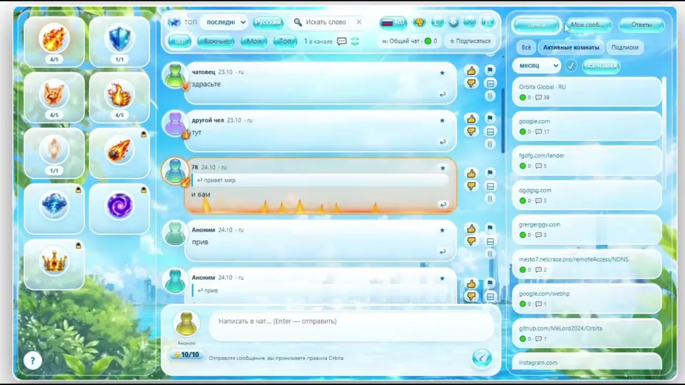

# Orbita — чат поверх любого сайта

[English](README.md) · [**Русский**](README.ru.md)

**[▶ Посмотреть 12-секундное видео](docs/preview.mp4)**

**Один адрес — одна беседа.** Orbita — бесплатный полупрозрачный чат поверх страниц в Chromium-браузерах. Открываете статью, видео или обсуждение и общаетесь с людьми, которые смотрят ту же страницу.

По умолчанию включён ностальгический стеклянный стиль **Frutiger Aero**.

## ✨ Возможности

- **Чат на любом сайте:** перемещение, изменение размера и прозрачности окна.
- **Без регистрации:** общение анонимно; отдельный ник для каждого сайта.
- **Комнаты по адресу и языку:** можно объединять зеркала сайтов.
- **Реакции сообщества:** голоса ▲/▼, звёзды, жалобы и сворачивание комментариев.
- **Анимации:** перетаскивайте на сообщения огонь, щит, огненные рога, лайк или **«Тишину»**. «Тишина» останавливает анимации комнаты на три минуты. Заряды восстанавливаются через 24 часа после использования.
- **Правая панель:** общий топ, ваши сообщения и ответы.
- **Настройка оформления:** скины, фоны, градиенты и звуки уведомлений.
- **Языки:** 8 языков интерфейса и 54 языка комнат.

## 🚀 Установка

**Нужен:** Chrome или другой браузер на Chromium версии 114+.

1. **[Скачайте последнюю сборку](https://github.com/MeLord2024/Orbita/releases/latest)** и распакуйте архив в постоянную папку.
2. Откройте `chrome://extensions` и включите **Режим разработчика**.
3. Нажмите **Загрузить распакованное расширение** и выберите папку **`extension`** (в ней находится `manifest.json`).
4. Откройте любой сайт и нажмите **Alt+O** (или **Alt+Shift+O**) либо значок Orbita.

> Если сочетание клавиш занято, назначьте другое на странице `chrome://extensions/shortcuts`. Сейчас расширение устанавливается вручную, не через Chrome Web Store.

## 🔒 Приватность и синхронизация

Общие комнаты синхронизируются через сервер. **Синхронизация включена по умолчанию**, но её можно отключить в настройках для локального режима. Согласно документации проекта, сообщения на общем сервере хранятся 30 дней. **Не отправляйте в публичные комнаты конфиденциальную информацию.**

## 📚 Документация

| | English | Русский |
|---|---|---|
| Подробные возможности и технические детали | [English docs](docs/FEATURES.en.md) | [Полная документация](docs/FEATURES.ru.md) |
| Инструкция по установке | [INSTALL.md](INSTALL.md) *(на русском)* | [Установка](INSTALL.md) |

**Версия документации:** v0.4.33 · [Скачать](https://github.com/MeLord2024/Orbita/releases) · [Исходный код](https://github.com/MeLord2024/Orbita)
